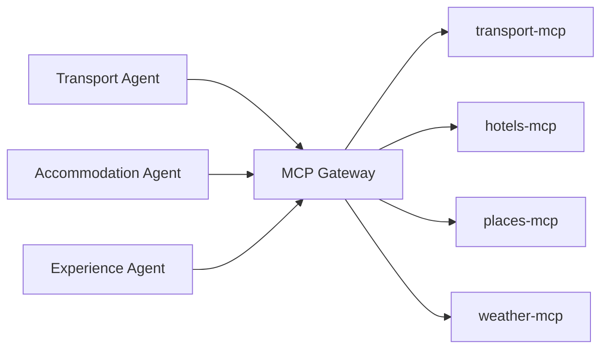
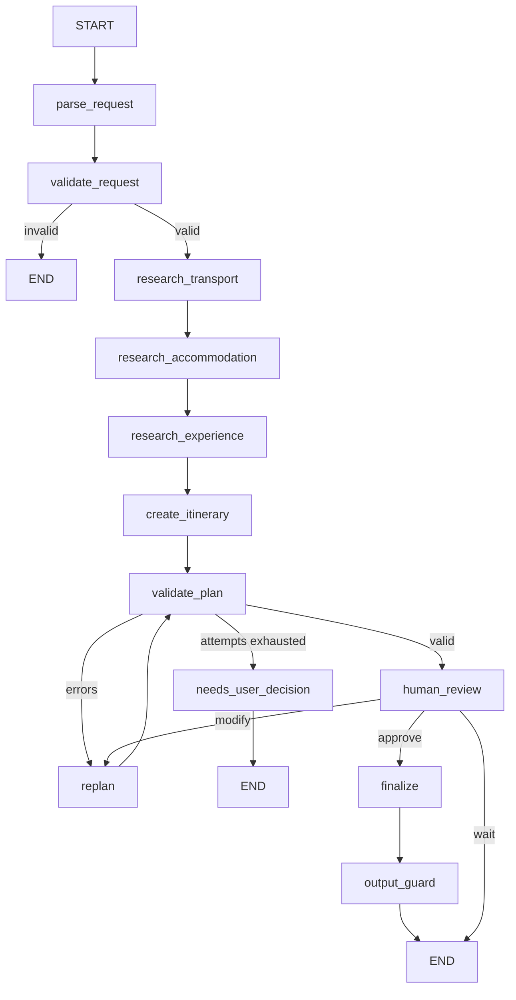

# AI Travel Planning Agent

Multi-agent travel planner built with **LangGraph** and **MCP**, with deterministic
validation, re-planning, and human-in-the-loop approval.

> **Status: Phase 13 of 17.** Evaluation dataset and runner.
> See [PROJECT_PLAN.md](PROJECT_PLAN.md) for the full architecture and phase plan.

## Quick start

```bash
python3 -m venv .venv && source .venv/bin/activate
pip install -r requirements-dev.txt
cp .env.example .env          # works as-is: USE_MOCK_DATA=true, no API keys needed
uvicorn app.main:app --reload
```

Then: <http://localhost:8000/health> · <http://localhost:8000/docs>

```bash
curl -X POST localhost:8000/api/v1/trips -H 'Content-Type: application/json' \
  -d '{"message":"Plan a 5 day trip from Kochi to Delhi for 2 people under Rs 50000"}'
```

## Evaluation

```bash
python -m evaluation.evaluate           # 18 cases, mock data, no LLM
python -m evaluation.evaluate --llm     # against whatever LLM is configured
python -m evaluation.evaluate --case basic_trip
```

18 cases in [evaluation/dataset.json](evaluation/dataset.json), each carrying a
`why` so it is clear what would be lost if it were deleted. They cover request
extraction, preference following (honoured *and* overridden), budget arithmetic,
weather-aware scheduling, invalid and off-topic requests, prompt injection,
human modification and approval, partial and total MCP failure, running with no
LLM at all, and cross-domain tool authorization.

Expectations are structural rather than exact strings - a chosen mode, a day
count, a budget respected - so the suite tests behaviour and not wording. The
runner exits non-zero on any failure, so CI can use it.

## Observability

Every log line is JSON with the same shape, so one trip can be followed end to
end by filtering on a single field:

```json
{"event": "tool_call", "trip_id": "3690ce...", "request_id": "2eb38d8b3ff4",
 "agent": "transport_agent", "tool": "search_trains", "duration_ms": 0.9,
 "status": "ok", "cache_hit": false}
```

`request_id` and `trip_id` are bound once per request and appear on every line
underneath - the agents and the gateway never pass ids around. The request id
also comes back as an `X-Request-ID` header, and one you supply is kept, so a
caller can trace a request they already have an id for.

Secrets are removed by a processor rather than by remembering not to log them:
by field name (`api_key`, `password`, `token`, ...) and by shape, so a key
pasted into an innocently named field is caught too.

`APP_ENV=development` renders for humans; anything else renders JSON.

### Metrics

`GET /metrics`, in Prometheus format. Four of them, each answering a question
someone would actually ask when the system misbehaves:

| Metric | Question |
|---|---|
| `llm_calls_total{provider,status}` | is the primary LLM failing, and are we falling back? |
| `tool_calls_total{tool,status,cache_hit}` | which tools error, and is the cache doing anything? |
| `trip_validation_failures_total{reason}` | what do plans fail validation for? |
| `node_duration_seconds{node}` | which part of the workflow is slow? |

Every node is timed by wrapping it once in `build_graph`, so no node knows it is
being measured. Validation errors are grouped into a handful of stable reasons -
one label per wording would make the metric useless.

No exporter, no collector, no Grafana. Those would be decoration at this size.

## Human in the loop

Once a plan validates, the workflow **stops**. LangGraph's `interrupt()` saves the
state to the checkpointer and the API returns the plan with what it is waiting
for. A later call resumes the same node with the traveller's answer - from a
different process, if need be.

```
POST /api/v1/trips              -> plan, then pause
POST /api/v1/trips/{id}/modify  -> change it, re-plan, pause again
POST /api/v1/trips/{id}/approve -> finalise, or reject with {"approved": false}
POST /api/v1/trips/{id}/message -> a reply to a waiting plan is a modification
```

Approval is asked **once per version of the plan**, never per tool call.

A modification is not the same as automatic re-planning. Automatic re-planning
reacts to validation errors by squeezing the numbers; a modification changes the
requirements, so it re-runs the experience research and rebuilds the plan. Asking
to *"reduce hotel cost and add more historical places"* does both halves:

```
before:  hotel Rs 18,200   food places only        total Rs 27,620
after:   hotel Rs  9,200   + India Gate, Jama Masjid, Delhi Old Fort
                                                    total Rs 20,320
```

A plan that re-planning could not rescue is offered as **modify or reject only** -
never approve, because the output guard would reject it anyway. Raising the
budget from there rescues the trip and it becomes approvable.

## Persistence

Two places, answering two different questions.

**The LangGraph checkpointer** writes the workflow state to Postgres after every
node. That is what makes a trip resumable: the API can stop at human review and a
different process can pick the same trip up later. Verified by killing the
process and asking a fresh one for the trip - it comes back complete.

**The `trips` and `trip_events` tables** answer what the checkpointer cannot:
list recent trips, look one up by status, see what happened to it and when. Two
tables, with the plan itself in JSONB, because trips are queried by id and status
rather than by hotel rating.

Postgres is where a trip is *remembered*, not where it is *planned*. With no
database the system still plans normally; it just forgets. `GET /health` reports
which of the two you are running.

| Endpoint | |
|---|---|
| `POST /api/v1/trips` | plan a trip |
| `GET /api/v1/trips` | recent trips, from Postgres |
| `GET /api/v1/trips/{id}` | one trip, resumed from the checkpointer |
| `GET /api/v1/trips/{id}/events` | that trip's audit trail |

## Re-planning

When validation fails, [app/validation/replan.py](app/validation/replan.py) tries
four levers in a fixed order, cheapest change to the traveller first:

1. a cheaper hotel (best rated among the cheaper options, not simply the cheapest)
2. a cheaper transport option that still respects a stated time limit - and says
   so plainly when nothing cheap enough fits it
3. swap the priciest paid activity for a free one, or drop it
4. move outdoor activities off wet days onto dry ones

Each attempt applies the first lever that changes something, and the option it
used is removed from the pool, so the next attempt moves on. Three attempts, then
the traveller is asked to raise the budget or relax a preference. There is no
optimiser, and there does not need to be: the validator has the final say.

**The rule that keeps this honest:** a problem is only reported when it can
actually be fixed. Rain is not a defect if there is nowhere drier to move to, and
a slow journey is not a defect if nothing faster existed. The validator and the
re-planner test the same conditions, so the loop cannot spin on something no
lever can reach.

## Guardrails and validation

The dividing line the whole project is built on:

| The LLM | Python |
|---|---|
| reads the traveller's message | computes every date |
| writes the itinerary's prose | computes every rupee |
| explains a recommendation | decides whether a plan is valid |

**Input** ([app/guardrails/input_guard.py](app/guardrails/input_guard.py)) runs in
two places: `check_message` screens the raw text before it reaches a model
(empty, over-long, prompt injection); `check_requirements` checks the extracted
fields (missing city, origin equal to destination, impossible duration or
traveller count, nonsensical budget, broken date range).

Injection filtering is a speed bump, not a wall. The real defences are the
restricted tool access and the validation that follow it.

**Plan validation** ([app/validation/validators.py](app/validation/validators.py))
is six plain functions - dates, transport, hotel, itinerary, daily schedule,
budget - each returning a list of readable errors. No LLM is consulted.

**Output** ([app/guardrails/output_guard.py](app/guardrails/output_guard.py))
re-derives the totals rather than trusting the ones in the state, so a number
that drifted during re-planning is caught before the traveller sees it. It also
blocks anything resembling a credential.

## LLM fallback

```
primary (Groq) --fails--> fallback (Gemini) --fails--> rule-based reading
```

> **Picking a model.** Groq retires models periodically, and the default here
> (`openai/gpt-oss-120b`) may not be on your account. If a call 404s with
> `model_not_found`, list what you have and set `GROQ_MODEL` to one of them:
>
> ```python
> from groq import Groq; print([m.id for m in Groq(api_key="...").models.list().data])
> ```
>
> Put real keys in `.env`, never in `.env.example` - that file is committed.

One retry on the primary covers a transient blip; after that the fallback gets
one attempt. A reply that does not match the Pydantic schema counts as a
failure, so a malformed answer falls back too rather than being half-trusted.

There is no router, no model scoring and no cost optimiser. The only question
this design answers is "the primary is down, can we keep going?".

If **no** provider answers - including the case where no API key is configured at
all - requirements are read with a plain keyword reader instead, and the response
says so:

```json
"degraded": ["no LLM available, requirements were read with simple rules"]
```

That is what lets the whole system run with zero API keys. A degraded extraction
is always labelled; it never passes for a normal one.

## Data sources

`USE_MOCK_DATA=true` (the default) runs the whole system offline with no API keys.
Every payload carries a `source` field, so where a result came from is visible in
the data and not only in the configuration.

| Domain | Mock | Real, with `USE_MOCK_DATA=false` |
|---|---|---|
| Hotels | rating-correlated pricing | **trivago's public MCP server** - live prices, no key |
| Weather | seasonal, deterministic | Open-Meteo - free, no key |
| Routes | distance x road factor | OSRM - free, no key |
| Flights, trains, buses | derived from real distances | *mock only* - no free keyless API exists |
| Places | curated + generated | *mock only* - same |

### Why some domains are still ours

Where a free public MCP server exists and is good, we call it. [trivago's](https://mcp.trivago.com/docs)
is hosted, needs no key, and returns live prices from the major booking sites -
strictly better than anything we could mock, so `search_hotels` calls it.

For Indian flights, trains and buses there is no equivalent. The MCP servers that
cover them wrap RapidAPI or Amadeus and need a paid subscription, so those tools
always serve mock data and tag every record `"source": "mock"`. That tag travels
all the way to the plan, so where a number came from is visible in the answer and
not only in the configuration.

Two things worth knowing about calling somebody else's MCP server, both learned
by doing it:

- **Its output is not your schema.** trivago answers with `"₹12,599"` and a score
  out of ten; the rest of this system wants numbers and a rating out of five. The
  mapping lives in one adapter so nothing downstream learns a second format.
- **Its output may address your model.** trivago's tool result opens with
  *"IMPORTANT: ... You MUST follow them exactly."* That is a third party issuing
  instructions to our LLM. Almost certainly meant helpfully, but a tool result is
  data, not a prompt, so it is stripped before we look at it. This is the clearest
  argument for the gateway existing at all: it is the one place where somebody
  else's output becomes our data.

## Caching and failure handling

Redis caches read-tool results, keyed on the tool name plus its sorted arguments,
with a lifetime per tool: 15 minutes for prices, an hour for weather, a day for
places and routes. Locally that turns a 298 ms search into a 0.4 ms one.

Redis is a speed-up, never a source of truth. If it is down the system plans
normally, and the rate limiter falls back to an in-process counter rather than
quietly letting every call through.

When an MCP server fails:

- **Part of a domain** (trains down, flights up) - the plan continues on what is
  left and the response says what was missed.
- **A whole leg** (no transport at all, or no hotel) - the plan is rejected. An
  itinerary with no way to get there is not a cheap plan, it is an incomplete
  one, and the total would silently omit the cost.

The message tells the truth about which happened: an outage is never reported as
a budget problem.

## MCP Gateway

Every tool call goes through the gateway. It is the only door between the agents
and the MCP servers.



| Responsibility | How |
|---|---|
| Authentication | `X-API-Key` header must match `MCP_GATEWAY_API_KEY` |
| Identity | `X-Agent-Name` header says which agent is calling |
| Authorization | `AGENT_TOOL_ACCESS` in [gateway/policy.py](gateway/policy.py); a cross-domain call is `403` |
| Discovery | `GET /tools` returns only that agent's tools, so its LLM never sees the rest |
| Routing | `TOOL_SERVER` maps each tool to the MCP server that owns it |
| Rate limiting | 60 calls/agent/minute, `429` beyond that (Redis-backed in Phase 6) |
| HITL | action tools (`book_*`) are refused without an approval token |
| Logging | one line per call: agent, tool, trip, duration, status |

Failures map to status codes an agent can act on: `503` for an unreachable MCP
server (carry on with the other tools), `400` for bad arguments, `429` for rate
limits, `403` for anything unauthorized.

### One process or five

`SPLIT_PROCESSES=false` (the default) runs the agents, gateway and MCP servers
in one process: no ports to manage, fast tests. `SPLIT_PROCESSES=true` makes both
hops real HTTP - agents to gateway, gateway to MCP - which is how docker-compose
runs it. Start the extra processes with `python scripts/run_services.py`.

The authorization, rate limiting and routing code is identical either way; only
the wire between the pieces changes.

## MCP servers

Four custom MCP servers built with FastMCP, each serving streamable HTTP at `/mcp`:

| Server | Port | Tools |
|---|---|---|
| `mcp_servers/transport` | 9101 | `search_flights`, `search_trains`, `search_buses` |
| `mcp_servers/hotels` | 9102 | `search_hotels` |
| `mcp_servers/places` | 9103 | `search_places`, `calculate_route` |
| `mcp_servers/weather` | 9104 | `get_weather` |

Run one standalone with `python -m mcp_servers.transport.server`. Routes live in
the places server because both tools answer geography questions from the same
city table - a maps server of its own would be a folder for appearance.

## Agents and tool access

| Agent | Tools it may call |
|---|---|
| Travel Manager | none - it builds a scoped brief for each agent and merges their results |
| Transport Agent | `search_flights`, `search_trains`, `search_buses` |
| Accommodation Agent | `search_hotels` |
| Experience Agent | `search_places`, `get_weather`, `calculate_route` |

The table lives in [gateway/policy.py](gateway/policy.py) and is enforced on every
tool call. Phase 5 enforces the same table over HTTP at the MCP Gateway.

## Workflow



## Tests

```bash
pytest -q
ruff check . && ruff format --check .
```

## Documentation

- [PROJECT_PLAN.md](PROJECT_PLAN.md) — architecture, agents, MCP design, phases
- `docs/interview-guide.md` — coming in Phase 17
