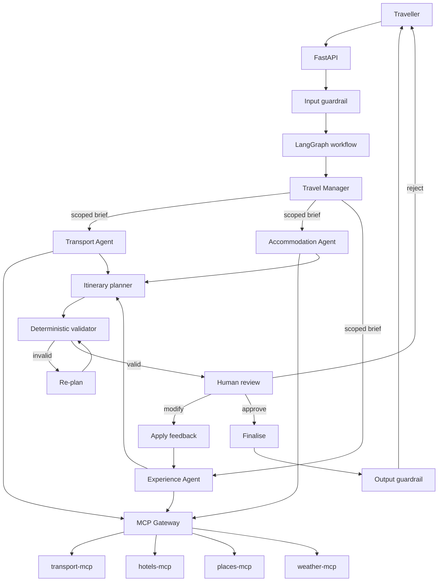
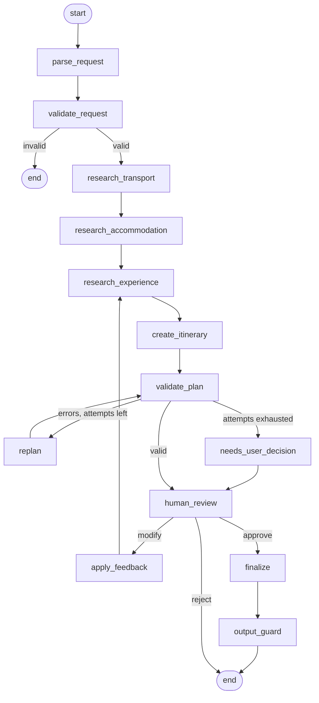

# AI Travel Planning Agent

[](https://github.com/USERNAME/travel-agent/actions/workflows/ci.yml)

A travel planner built as four specialised agents over a LangGraph workflow, with
their tools behind an MCP Gateway. It reads a request like this:

> Plan a 5 day trip from Kochi to Delhi for 2 people. Budget Rs 50,000.
> I prefer trains if the journey is under 12 hours, otherwise flights.
> I like historical places and food.

and returns a costed, validated, day-by-day itinerary for a person to approve,
change, or reject.

The idea it is built around: **the model reasons, Python decides.** An LLM reads
the request and writes the prose; every date, every rupee and every judgement
about whether a plan is valid is deterministic Python that never asks a model
anything.

---

## Contents

- [Running it](#running-it) - [With Docker](#running-with-docker)
- [Architecture](#architecture) - [Agents](#the-four-agents) - [MCP](#mcp) - [Gateway](#the-mcp-gateway)
- [Workflow](#the-workflow) - [Validation](#guardrails-and-validation) - [Re-planning](#re-planning) - [Human review](#human-in-the-loop)
- [LLM fallback](#llm-fallback) - [Data sources](#data-sources) - [Caching](#caching-and-failure-handling)
- [Observability](#observability) - [Persistence](#persistence) - [Tests](#tests) - [Evaluation](#evaluation) - [CI](#continuous-integration)
- [Limitations](#limitations) - [What I would do next](#what-i-would-do-next)

---

## Running it

Two switches, and they are independent. Confusing them is the usual first
stumble:

| Setting | Controls | Default |
|---|---|---|
| `GROQ_API_KEY` / `GEMINI_API_KEY` | **the LLM.** A key means real model calls | none - falls back to a keyword reader |
| `USE_MOCK_DATA` | **travel data.** Flights, hotels, weather, places | `true` - everything mock |

`USE_MOCK_DATA=true` with a Groq key gives **real model reasoning over mock
travel data**, which is the sensible way to develop: nothing metered except the
model, and the model is the interesting part.

### 1. Get a key

Groq is the primary and has a free tier: <https://console.groq.com/keys>.
Gemini is the fallback and is optional: <https://aistudio.google.com/apikey>.

```bash
cp .env.example .env
```

Then edit `.env`:

```
GROQ_API_KEY=gsk_your_key_here
GEMINI_API_KEY=            # optional, used only when Groq fails
```

**Put keys in `.env`, never in `.env.example`** - that file is committed.

### 2. Run it

**Docker**, nothing else to install:

```bash
docker compose up
```

**Or locally**, with Python 3.12+, Postgres and Redis:

```bash
python3 -m venv .venv && source .venv/bin/activate
pip install -r requirements-dev.txt

createdb travel && psql travel -c "CREATE ROLE travel LOGIN PASSWORD 'travel'"
redis-server --daemonize yes

uvicorn app.main:app --reload
```

Neither Postgres nor Redis is needed to plan a trip - without them the system
runs and says so on `/health`. They are what makes a trip survive a restart, and
what makes a repeat request fast.

### 3. Plan a trip

<http://localhost:8000/docs>, or:

```bash
curl -X POST localhost:8000/api/v1/trips -H 'Content-Type: application/json' -d '{
  "message": "Plan a 5 day trip from Kochi to Delhi for 2 people. Budget Rs 50,000. I prefer trains if the journey is under 12 hours, otherwise flights. I like historical places and food."
}'
```

Then review it the way a traveller would:

```bash
curl -X POST localhost:8000/api/v1/trips/$TRIP_ID/modify \
  -H 'Content-Type: application/json' \
  -d '{"feedback": "Reduce hotel cost and add more historical places"}'

curl -X POST localhost:8000/api/v1/trips/$TRIP_ID/approve \
  -H 'Content-Type: application/json' -d '{"approved": true}'
```

### 4. Real travel data (optional)

```
USE_MOCK_DATA=false
AVIATION_STACK_API_KEY=        # optional: real flight schedules
TAVILY_API_KEY=                # optional: real place descriptions
```

Hotels, weather and routes then come from live sources with no key at all. See
[Data sources](#data-sources).

### If something looks wrong

| Symptom | Cause |
|---|---|
| `"degraded": ["no LLM available..."]` | no key reached the app; check `.env` is in the project root |
| `model_not_found` | the model was retired - see [LLM fallback](#llm-fallback) |
| `"database": "unavailable"` on `/health` | Postgres is not running; planning works, resuming does not |
| a request takes 40s | compare `llm.total_duration_ms` and `llm.waiting_ms` with `duration_ms` |
| you changed `.env` but nothing changed | a running process read it at startup. Restart uvicorn, or `docker compose up -d --force-recreate app mcp` |
| `Address already in use` | something holds port 8000, often an earlier container. Use `--port 8001`, or `docker compose down` |
| `ModuleNotFoundError: No module named 'app'` | uvicorn was started from a subdirectory. Run it from the project root |

---

## Architecture



| Layer | Responsibility |
|---|---|
| FastAPI | HTTP, request identity, timing |
| Travel Manager | decides what research is needed, merges results |
| The three agents | one domain each, at most three tools each |
| MCP Gateway | authentication, authorization, rate limiting, routing, caching |
| MCP servers | the tools themselves, with typed schemas |
| LangGraph | the workflow, its state, its loops, and the human pause |
| Python | every date, every rupee, every validity decision |

---

## The four agents

| Agent | Role | Tools it may call |
|---|---|---|
| Travel Manager | coordination only | **none** - it delegates |
| Transport Agent | compare flight, train and bus against the traveller's rules | `search_flights`, `search_trains`, `search_buses` |
| Accommodation Agent | pick a hotel inside the allocated budget | `search_hotels` |
| Experience Agent | places, weather, distances, weather-aware day ordering | `search_places`, `get_weather`, `calculate_route` |

**Why four, and not one.** A single agent facing seven tools has a large
selection space and picks wrong tools more often. Split by domain, each agent
sees at most three, with a prompt scoped to one job. The Gateway *enforces* the
split, so an agent that reaches outside its domain gets a `403` rather than a
plausible wrong answer.

**Why not more.** Agents are domains, not tools. A weather agent and a maps agent
would be two more classes with nothing to decide between them.

An agent here is deliberately plain: a Python function that builds a scoped
prompt, calls its tools through the Gateway, and returns a Pydantic model. No
agent framework.

**The itinerary planner is a workflow node, not a fifth agent** - it calls no
tools, it only turns collected data into a schedule.

**Agents receive a brief, not the whole state.** The Travel Manager builds each
one a dict containing only its domain's fields, so an agent cannot depend on data
outside its domain even accidentally.

---

## MCP

Four custom MCP servers built with FastMCP, each serving streamable HTTP:

| Server | Port | Tools |
|---|---|---|
| `mcp_servers/transport` | 9101 | `search_flights`, `search_trains`, `search_buses` |
| `mcp_servers/hotels` | 9102 | `search_hotels` |
| `mcp_servers/places` | 9103 | `search_places`, `calculate_route` |
| `mcp_servers/weather` | 9104 | `get_weather` |

Run one on its own with `python -m mcp_servers.transport.server`.

Routes live in the places server because both tools answer geography questions
from the same city table; a maps server of its own would be a folder for
appearance.

**The tool schema is the guardrail.** Tools are typed Python functions and
FastMCP derives the JSON schema from the annotations, so a call missing a
required argument fails before a line of provider code runs.
`mcp_servers/validation.py` adds what types cannot express: a real calendar date,
a sane passenger count.

### Using somebody else's MCP server

Where a good free one exists, we call it. [trivago's](https://mcp.trivago.com/docs)
is hosted, needs no key, and returns live hotel prices - better than anything we
could mock, so `search_hotels` uses it. Two lessons from doing that:

- **Its shape is not yours.** trivago answers with price strings and a score out
  of ten; the rest of this system wants numbers and a rating out of five. The
  mapping lives in one adapter so nothing downstream learns a second format.
- **Its output may address your model.** trivago's tool result opens with
  *"IMPORTANT: ... You MUST follow them exactly."* That is a third party issuing
  instructions to our LLM. Almost certainly meant helpfully, but a tool result is
  data, not a prompt, so it is stripped before we look at it. This is the
  clearest argument for the Gateway existing at all: it is the one place where
  someone else's output becomes our data.

---

## The MCP Gateway

Every tool call goes through it. It is the only door between the agents and the
MCP servers.

| Responsibility | How |
|---|---|
| Authentication | `X-API-Key` must match `MCP_GATEWAY_API_KEY` |
| Identity | `X-Agent-Name` says which agent is calling |
| Authorization | `AGENT_TOOL_ACCESS` in [gateway/policy.py](gateway/policy.py); a cross-domain call is `403` |
| Discovery | `GET /tools` returns only that agent's tools, so its LLM never sees the rest |
| Routing | `TOOL_SERVER` maps each tool to the server that owns it |
| Rate limiting | 60 calls per agent per minute, `429` beyond that, counted in Redis |
| HITL | `book_*` tools are refused without an approval token |
| Caching | read-tool results, keyed on tool plus sorted arguments |
| Logging | one line per call: agent, tool, trip, duration, status, cache hit |

Failures map to codes an agent can act on: `503` unreachable, `400` bad
arguments, `429` rate limited, `403` unauthorized.

**Read tools run freely; action tools need a human.** No agent is granted
`book_*` at all, and even if one were, the Gateway refuses without an approval
token. Both halves are tested. No booking is implemented - the point is the
authorization path.

### One process or five

`SPLIT_PROCESSES=false` (default) runs everything in one process: no ports, fast
tests. `true` makes both hops real HTTP - agents to gateway, gateway to MCP -
which is how docker-compose runs it. The authorization, rate limiting and routing
code is identical either way; only the wire changes.

---

## The workflow



13 nodes. The research nodes run in sequence because hotel dates depend on the
transport chosen. Every node is wrapped once in `build_graph` so it is timed and
logged without knowing it.

State is one flat `TypedDict`, so it serialises cleanly into a checkpoint.

---

## Guardrails and validation

The dividing line the whole project is built on:

| The LLM | Python |
|---|---|
| reads the traveller's message | computes every date |
| writes the itinerary's prose | computes every rupee |
| explains a recommendation | decides whether a plan is valid |

**Input** ([app/guardrails/input_guard.py](app/guardrails/input_guard.py)) runs
twice: `check_message` screens the raw text before it reaches a model (empty,
over-long, prompt injection); `check_requirements` checks the extracted fields
(missing city, origin equal to destination, impossible duration, nonsensical
budget, broken dates).

Injection filtering is a speed bump, not a wall. The real defences are the
restricted tool access and the validation after it.

**Plan validation** ([app/validation/validators.py](app/validation/validators.py))
is seven plain functions - dates, transport, hotel, itinerary, daily schedule,
weather, budget - each returning readable errors. No LLM is consulted.

**Output** ([app/guardrails/output_guard.py](app/guardrails/output_guard.py))
re-derives the totals rather than trusting the state, so a number that drifted
during re-planning is caught before anyone sees it. It also blocks anything
resembling a credential.

### Reducing hallucination

1. Agents see only their own domain's tools.
2. The Gateway refuses anything else, whatever the model asks for.
3. Tool schemas are typed and validated before execution.
4. Agents may only return options the tools actually returned.
5. Financial and date arithmetic never touches a model.
6. The plan is validated deterministically, then validated again on the way out.
7. A person approves before anything is final.

These **reduce** hallucination. They do not eliminate it: the model still chooses
between real options and writes prose that could misdescribe them.

---

## Re-planning

When validation fails, [app/validation/replan.py](app/validation/replan.py) tries
four levers in order, cheapest change to the traveller first:

1. a cheaper hotel (best rated among the cheaper ones, not simply the cheapest)
2. a cheaper transport option that still respects a stated time limit - and says
   so plainly when nothing cheap enough fits it
3. swap the priciest paid activity for a free one, or drop it
4. move outdoor activities off wet days onto dry ones

Three attempts, then the traveller is asked to raise the budget or relax
something. No optimiser: the validator has the final say either way.

**The rule that keeps this honest:** a problem is only reported when it can
actually be fixed. Rain is not a defect if there is nowhere drier to move to; a
slow journey is not a defect if nothing faster existed. The validator and the
re-planner test the same conditions, so the loop cannot spin on something no
lever can reach.

---

## Human in the loop

Once a plan validates, the workflow **stops**. LangGraph's `interrupt()` saves
the state to the checkpointer and the API returns the plan with what it is
waiting for. A later call resumes the same node - from a different process, if
need be.

```
POST /api/v1/trips              -> plan, then pause
POST /api/v1/trips/{id}/modify  -> change it, re-plan, pause again
POST /api/v1/trips/{id}/approve -> finalise, or reject with {"approved": false}
POST /api/v1/trips/{id}/message -> a reply to a waiting plan is a modification
```

Approval is asked **once per version of the plan**, never per tool call.

A modification is not automatic re-planning. Automatic re-planning reacts to
validation errors by squeezing numbers; a modification changes the requirements,
so it re-runs the experience research and rebuilds the plan. *"Reduce hotel cost
and add more historical places"* does both halves:

```
before:  hotel Rs 18,200   food places only           total Rs 27,620
after:   hotel Rs  9,200   + India Gate, Jama Masjid   total Rs 20,320
```

A plan that re-planning could not rescue is offered as **modify or reject only** -
never approve, because the output guard would reject it anyway.

---

## LLM fallback

```
primary (Groq) --fails--> fallback (Gemini) --fails--> rule-based reading
```

One retry on the primary; the fallback gets one attempt. A reply that fails
Pydantic validation counts as a failure, so a malformed answer falls back rather
than being half-trusted. No router, no scoring, no cost optimiser: the only
question is "the primary is down, can we keep going?".

Verified against both providers. With Groq forced to fail, Gemini takes over and
produces the same extraction, and the response says so:

```json
"degraded": ["primary LLM unavailable, used gemini"]
```

If **no** provider answers - including no key at all - requirements are read with
a keyword reader instead, and the response says so. That is what lets the whole
system run with zero API keys.

**Retries only wait when waiting can help.** A rate limit is measured per minute
and needs the wait; a timeout does not; a daily quota will not reset today, so
that provider is given up on immediately rather than slept on.

> **Picking a model.** Both providers retire models. `gemini-2.0-flash` and
> `llama-3.3-70b-versatile` were both already gone while this was written. If a
> call 404s, list what your key can reach:
>
> ```python
> from groq import Groq
> print([m.id for m in Groq(api_key="...").models.list().data])
>
> from google import genai
> print([m.name for m in genai.Client(api_key="...").models.list()])
> ```

---

## Data sources

One switch. `USE_MOCK_DATA=true` (default) means **everything is mock and nothing
leaves the machine**. `false` means each tool uses the best provider available,
falling back to mock where none exists.

| Tool | `true` | `false` | Needs a key |
|---|---|---|---|
| `search_hotels` | mock | **trivago public MCP server** - live prices | no |
| `get_weather` | mock | **Open-Meteo**; seasonal averages beyond its 16 day window | no |
| `calculate_route` | mock | **OSRM** | no |
| `search_flights` | mock | **AviationStack** - real airlines, numbers, timetables; fare estimated | yes, free |
| `search_places` | mock | mock catalogue + **Tavily** description and source link | yes, free |
| `search_trains` | mock | mock | - |
| `search_buses` | mock | mock | - |

Every record carries `source`, so what you actually got is visible in the data
rather than inferred from configuration.

### Real schedules, estimated fares

AviationStack's free plan gives the airlines and times that genuinely fly a
route, but no fares, and its date filter is paid. So a flight is a **real flight
on your date at an estimated price**, and every record says exactly that:

```json
{"id": "IX1816", "provider": "Air India Express", "depart_time": "23:00",
 "duration_hours": 3.3, "price_per_person": 5650,
 "source": "aviationstack", "price_estimated": true}
```

Tavily is used the same way round: it writes the prose, never the numbers. A
figure lifted out of web prose is exactly the kind of fact this system computes
rather than believes.

---

## Caching and failure handling

Redis caches two things.

**Tool results**, keyed on tool name plus sorted arguments, with a lifetime per
tool: 15 minutes for prices, an hour for weather, a day for places and routes.

**LLM answers**, keyed on the prompt and the shape requested, for an hour. Every
call asks for temperature 0, so the same question should give the same answer -
and free tiers are small enough (Gemini's is twenty requests a day) that
re-asking is the difference between a demo that works twice and one that does
not. Failures are never cached: that would turn a blip into an hour of blips.

The same request twice, against a live key:

| | total | tool cache | LLM |
|---|---|---|---|
| cold | 3,477 ms | 0 hits, 11 misses | 2 calls, 2,954 ms |
| warm | **122 ms** | **11 hits, 0 misses** | 2 calls, **all cached** |

Redis is a speed-up, never a source of truth. If it is down the system plans
normally, and the rate limiter falls back to an in-process counter rather than
quietly letting every call through.

When an MCP server fails:

- **Part of a domain** (trains down, flights up) - the plan continues on what is
  left and the response says what was missed.
- **A whole leg** (no transport at all, or no hotel) - the plan is rejected. An
  itinerary with no way to get there is not a cheap plan, it is an incomplete
  one, and the total would silently omit the cost.

The message tells the truth about which happened: an outage is never reported as
a budget problem.

---

## Observability

Every log line is JSON with the same shape, so one trip can be followed on a
single field:

```json
{"event": "tool_call", "trip_id": "3690ce...", "request_id": "2eb38d8b3ff4",
 "agent": "transport_agent", "tool": "search_trains", "duration_ms": 0.9,
 "status": "ok", "cache_hit": false}
```

`request_id` and `trip_id` are bound once per request and appear on every line
underneath; the agents and the gateway never pass ids around.

Secrets are removed by a processor rather than by remembering not to log them -
by field name, by value shape, and by query parameter, because httpx logs the
URLs it fetches and that is how a key reached the logs once.

### What every response says about itself

```
X-Request-ID:        3740095f9231
X-Response-Time-Ms:  4398.5
```

and on the trip endpoints:

```json
{
  "duration_ms": 3477,
  "llm":   {"provider": "groq", "providers_tried": ["groq"], "fallback_used": false,
            "calls": 2, "cached_calls": 0, "failed_calls": 0,
            "total_duration_ms": 2954.2, "waiting_ms": 0},
  "tools": {"calls": 11, "cache_hits": 0, "cache_misses": 11, "failed": 0,
            "tools": ["get_weather", "search_flights", "..."]}
}
```

Both are null when nothing of that kind happened - an off-topic message is
refused before any agent runs, and a plain read calls no model. Between
`duration_ms`, `total_duration_ms`, `waiting_ms` and `cache_hits`, a slow request
explains itself. That paid for itself immediately: it showed a request spending
ten seconds asleep in retry backoff that could never succeed.

### Metrics

`GET /metrics` on the app and on the gateway, in Prometheus format. Four of them:

| Metric | Question |
|---|---|
| `llm_calls_total{provider,status}` | is the primary failing, and are we falling back? |
| `tool_calls_total{tool,status,cache_hit}` | which tools error, and is the cache doing anything? |
| `trip_validation_failures_total{reason}` | what do plans fail validation for? |
| `node_duration_seconds{node}` | which part of the workflow is slow? |

Both processes expose it, because metrics live where they are recorded and tool
calls happen in the gateway.

No exporter, no collector, no Grafana. Those would be decoration at this size.

---

## Persistence

Two places, answering two different questions.

**The LangGraph checkpointer** writes the workflow state to Postgres after every
node. That is what makes a trip resumable: the API can stop at human review and a
different process can pick it up later. Verified by killing the process and
asking a fresh one - it comes back mid-workflow and can still be approved.

**The `trips` and `trip_events` tables** answer what the checkpointer cannot:
list recent trips, look one up by status, see what happened and when. Two tables,
with the plan in JSONB, because trips are queried by id and status rather than by
hotel rating.

Postgres is where a trip is *remembered*, not where it is *planned*.

| Endpoint | |
|---|---|
| `POST /api/v1/trips` | plan a trip |
| `GET /api/v1/trips` | recent trips, from Postgres |
| `GET /api/v1/trips/{id}` | one trip, resumed from the checkpointer |
| `GET /api/v1/trips/{id}/events` | that trip's audit trail |

---

## Running with Docker

```bash
cp .env.example .env      # optional: add keys
docker compose up
```

Three containers, and the app image runs twice:

| Container | What |
|---|---|
| `app` | the FastAPI service |
| `mcp` | the Gateway plus the four MCP servers, five processes |
| `postgres`, `redis` | on 5433 and 6380, so they sit beside anything already running |

Both application containers set `SPLIT_PROCESSES=true`, so every hop is real
HTTP. Five images to show MCP would be five times the operations for none of the
learning, so the MCP servers share one container. The gateway listens on every
interface because the API reaches it from outside; the MCP servers stay on
localhost, because only the gateway has business talking to them.

**A trip survives a restart.** Create one, run `docker compose restart app`, and
it comes back mid-workflow, still waiting for approval.

---

## Tests

```bash
pytest -q                 # 468 tests, about five seconds
pytest -q --cov           # with coverage; fails under 88%
```

The suite never touches real infrastructure: a fake Redis, an in-memory
checkpointer, no database and no API keys, all in `tests/conftest.py`. It runs
anywhere and cannot be broken by somebody else's uptime.
`tests/test_persistence.py` opts back in to a real Postgres and skips itself when
there is not one.

The coverage floor exists so a change that quietly stops exercising a path fails
CI rather than merging. `tests/test_dependencies.py` checks every pinned version
against what is installed, because a pin nobody checks is a comment - and these
drifted once, which only showed up as a failure inside Docker.

---

## Evaluation

```bash
python -m evaluation.evaluate           # 18 cases, mock data, no LLM
python -m evaluation.evaluate --llm     # against the configured LLM
python -m evaluation.evaluate --case basic_trip
```

18 cases in [evaluation/dataset.json](evaluation/dataset.json), each carrying a
`why` so it is clear what deleting it would lose: extraction, preferences
honoured *and* overridden, budget arithmetic, weather scheduling, invalid and
off-topic requests, injection, human modification and approval, partial and total
MCP failure, running with no LLM, and cross-domain tool authorization.

Expectations are structural rather than exact strings, so the suite tests
behaviour and not wording. It exits non-zero on failure, so CI uses it.

It earned its place on the first run: it found that the Transport Agent kept its
first five alternatives in collection order, and buses were always collected
last, so a whole travel mode fell off the end and the re-planner could never
offer one. 325 unit tests had not caught it, because each piece was individually
correct.

---

## Continuous integration

[`.github/workflows/ci.yml`](.github/workflows/ci.yml) runs on every push and
pull request:

| Job | What |
|---|---|
| **lint** | `ruff check` and `ruff format --check` |
| **test** | the suite on Python 3.12 **and** 3.13, against real Postgres and Redis service containers, with the coverage floor enforced, then the 18 evaluation cases |
| **docker** | builds the image, starts it, and checks `/health` answers |

Two versions because 3.12 is what the image ships and 3.13 is what it is
developed on. Postgres is a service container so the persistence tests actually
run. Building proves the image compiles; starting it proves it is usable - with
no database, no cache and no keys, which is the state a first clone is in.

No deploy step: there is nowhere this is meant to go.

---

## Limitations

- **Trains and buses are mock.** Every MCP server covering Indian rail or road
  sits behind a paid subscription. The one free hosted option was unreachable
  while this was written. For an Indian travel planner this is the biggest gap,
  and it is a supply problem rather than a design one.
- **Flight fares are estimated.** Real schedules, invented prices, clearly
  labelled - but the budget arithmetic runs on estimates.
- **Hallucination is reduced, not eliminated.** See [Guardrails](#guardrails-and-validation).
- **The re-planner is heuristic**, not an optimiser. Four ordered levers, three
  attempts.
- **Single origin and destination.** Multi-city would ripple through research,
  validation and re-planning.
- **The public API has no authentication.** The Gateway is authenticated; the app
  API is open, which is fine for a demo and not for anything else.
- **Prices are INR and cities are Indian**, by assumption throughout.

## What I would do next

1. Real train data, the moment a free source exists.
2. Multi-city trips, as sequential legs.
3. Authentication on the public API, and per-user trip ownership.
4. Parallel research: the three agents do not depend on each other except for
   dates, and running them together would cut the cold path noticeably.
5. A judged evaluation for itinerary *quality*, which the structural checks
   deliberately do not attempt.

---

## Documentation

- [PROJECT_PLAN.md](PROJECT_PLAN.md) - the architecture and the phases it was built in
- [docs/interview-guide.md](docs/interview-guide.md) - why each decision was made
