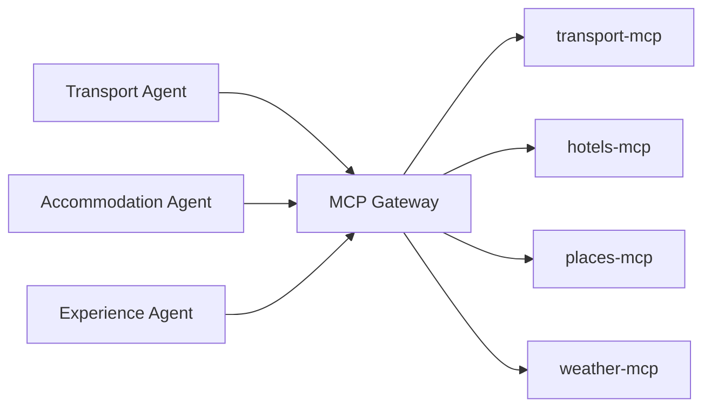
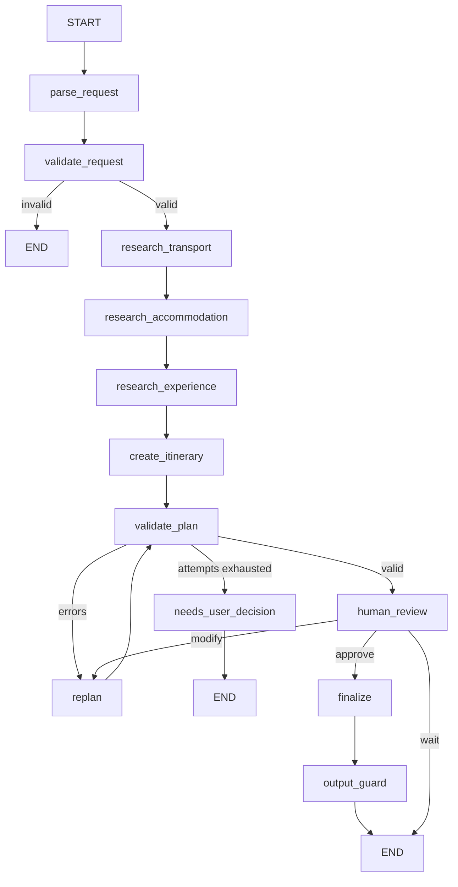

# AI Travel Planning Agent

Multi-agent travel planner built with **LangGraph** and **MCP**, with deterministic
validation, re-planning, and human-in-the-loop approval.

> **Status: Phase 5 of 17.** MCP Gateway enforcing authentication, authorization and rate limits.
> See [PROJECT_PLAN.md](PROJECT_PLAN.md) for the full architecture and phase plan.

## Quick start

```bash
python3 -m venv .venv && source .venv/bin/activate
pip install -r requirements-dev.txt
cp .env.example .env          # works as-is: USE_MOCK_DATA=true, no API keys needed
uvicorn app.main:app --reload
```

Then: <http://localhost:8000/health> · <http://localhost:8000/docs>

```bash
curl -X POST localhost:8000/api/v1/trips -H 'Content-Type: application/json' \
  -d '{"message":"Plan a 5 day trip from Kochi to Delhi for 2 people under Rs 50000"}'
```

## MCP Gateway

Every tool call goes through the gateway. It is the only door between the agents
and the MCP servers.



| Responsibility | How |
|---|---|
| Authentication | `X-API-Key` header must match `MCP_GATEWAY_API_KEY` |
| Identity | `X-Agent-Name` header says which agent is calling |
| Authorization | `AGENT_TOOL_ACCESS` in [gateway/policy.py](gateway/policy.py); a cross-domain call is `403` |
| Discovery | `GET /tools` returns only that agent's tools, so its LLM never sees the rest |
| Routing | `TOOL_SERVER` maps each tool to the MCP server that owns it |
| Rate limiting | 60 calls/agent/minute, `429` beyond that (Redis-backed in Phase 6) |
| HITL | action tools (`book_*`) are refused without an approval token |
| Logging | one line per call: agent, tool, trip, duration, status |

Failures map to status codes an agent can act on: `503` for an unreachable MCP
server (carry on with the other tools), `400` for bad arguments, `429` for rate
limits, `403` for anything unauthorized.

### One process or five

`SPLIT_PROCESSES=false` (the default) runs the agents, gateway and MCP servers
in one process: no ports to manage, fast tests. `SPLIT_PROCESSES=true` makes both
hops real HTTP - agents to gateway, gateway to MCP - which is how docker-compose
runs it. Start the extra processes with `python scripts/run_services.py`.

The authorization, rate limiting and routing code is identical either way; only
the wire between the pieces changes.

## MCP servers

Four custom MCP servers built with FastMCP, each serving streamable HTTP at `/mcp`:

| Server | Port | Tools |
|---|---|---|
| `mcp_servers/transport` | 9101 | `search_flights`, `search_trains`, `search_buses` |
| `mcp_servers/hotels` | 9102 | `search_hotels` |
| `mcp_servers/places` | 9103 | `search_places`, `calculate_route` |
| `mcp_servers/weather` | 9104 | `get_weather` |

Run one standalone with `python -m mcp_servers.transport.server`. Routes live in
the places server because both tools answer geography questions from the same
city table - a maps server of its own would be a folder for appearance.

## Agents and tool access

| Agent | Tools it may call |
|---|---|
| Travel Manager | none - it builds a scoped brief for each agent and merges their results |
| Transport Agent | `search_flights`, `search_trains`, `search_buses` |
| Accommodation Agent | `search_hotels` |
| Experience Agent | `search_places`, `get_weather`, `calculate_route` |

The table lives in [gateway/policy.py](gateway/policy.py) and is enforced on every
tool call. Phase 5 enforces the same table over HTTP at the MCP Gateway.

## Workflow



## Tests

```bash
pytest -q
ruff check . && ruff format --check .
```

## Documentation

- [PROJECT_PLAN.md](PROJECT_PLAN.md) — architecture, agents, MCP design, phases
- `docs/interview-guide.md` — coming in Phase 17
