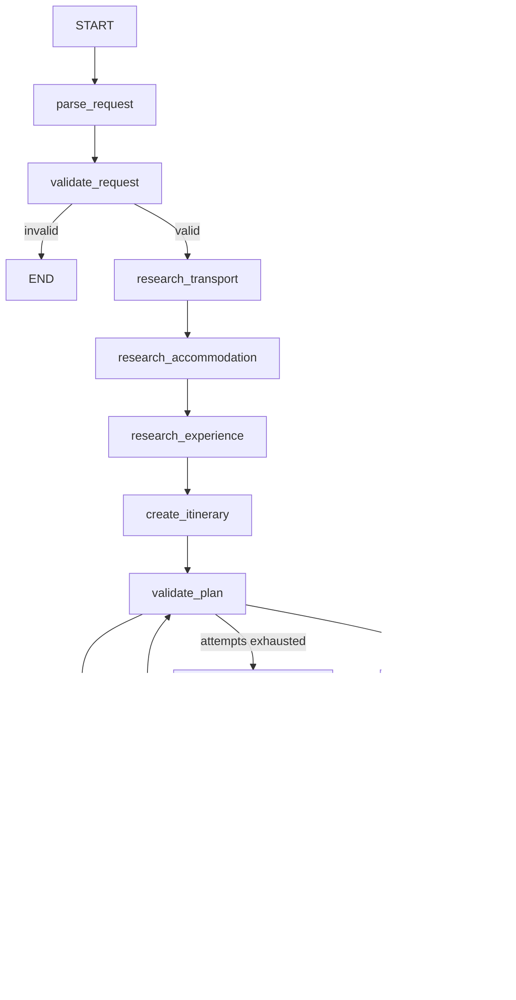

# AI Travel Planning Agent

[](https://github.com/harikrishnan/travel-agent/actions/workflows/ci.yml)

Multi-agent travel planner built with **LangGraph** and **MCP**, with deterministic
validation, re-planning, and human-in-the-loop approval.

> **Status: Phase 16 of 17.** CI on every push and pull request.
> See [PROJECT_PLAN.md](PROJECT_PLAN.md) for the full architecture and phase plan.

## Running it

There are two switches, and they are independent. Confusing them is the usual
first stumble:

| Setting | Controls | Default |
|---|---|---|
| `GROQ_API_KEY` / `GEMINI_API_KEY` | **the LLM.** A key means real model calls | none - falls back to a keyword reader |
| `USE_MOCK_DATA` | **travel data.** Flights, hotels, weather, places | `true` - everything mock |

So `USE_MOCK_DATA=true` with a Groq key gives you **real LLM reasoning over mock
travel data**, which is the sensible way to develop: nothing metered except the
model, and the model is the interesting part.

### 1. Get a key

Groq is the primary provider and has a free tier: <https://console.groq.com/keys>.
Gemini is the fallback and is optional: <https://aistudio.google.com/apikey>.

```bash
cp .env.example .env
```

Then edit `.env` and paste the key in:

```
GROQ_API_KEY=gsk_your_key_here
GEMINI_API_KEY=            # optional, used only when Groq fails
```

**Put keys in `.env`, never in `.env.example`** - that file is committed.

### 2. Run it, either way

**With Docker** - nothing else to install:

```bash
docker compose up
```

**Or locally** - needs Python 3.12+, Postgres and Redis:

```bash
python3 -m venv .venv && source .venv/bin/activate
pip install -r requirements-dev.txt

createdb travel && psql travel -c "CREATE ROLE travel LOGIN PASSWORD 'travel'"
redis-server --daemonize yes

uvicorn app.main:app --reload
```

Neither Postgres nor Redis is required to plan a trip - without them the system
runs and says so on `/health`. They are what makes a trip survive a restart, and
what makes repeated searches fast.

### 3. Plan a trip

<http://localhost:8000/docs> for the interactive API, or:

```bash
curl -X POST localhost:8000/api/v1/trips -H 'Content-Type: application/json' -d '{
  "message": "Plan a 5 day trip from Kochi to Delhi for 2 people. Budget Rs 50,000. I prefer trains if the journey is under 12 hours, otherwise flights. I like historical places and food."
}'
```

The response says which model answered it:

```json
"llm": {"provider": "groq", "fallback_used": false, "calls": 2,
        "total_duration_ms": 3706.1},
"duration_ms": 4858.8
```

Then review the plan the way a traveller would:

```bash
curl -X POST localhost:8000/api/v1/trips/$TRIP_ID/modify \
  -H 'Content-Type: application/json' \
  -d '{"feedback": "Reduce hotel cost and add more historical places"}'

curl -X POST localhost:8000/api/v1/trips/$TRIP_ID/approve \
  -H 'Content-Type: application/json' -d '{"approved": true}'
```

### 4. Turn on real travel data (optional)

```
USE_MOCK_DATA=false
AVIATION_STACK_API_KEY=        # optional: real flight schedules
TAVILY_API_KEY=                # optional: real place descriptions
```

Hotels, weather and routes then come from live sources with no key at all. See
[Data sources](#data-sources) for what each tool does and does not have.

### If something looks wrong

| Symptom | Cause |
|---|---|
| `"degraded": ["no LLM available..."]` | no key reached the app; check `.env` is in the project root |
| `model_not_found` | the model was retired - see the note under [LLM fallback](#llm-fallback) |
| `"database": "unavailable"` on `/health` | Postgres is not running; planning still works, resuming does not |
| a request takes 40s | the model is slow, not the app - compare `llm.total_duration_ms` with `duration_ms` |
| you changed `.env` but nothing changed | a running process read it at startup. Restart uvicorn, or `docker compose up -d --force-recreate app mcp` - containers capture `env_file` when they are created |
| `Address already in use` | something else holds port 8000, often a container from an earlier `docker compose up`. Use `--port 8001`, or `docker compose down` |
| `ModuleNotFoundError: No module named 'app'` | uvicorn was started from a subdirectory. Run it from the project root |

## Workflow



## Continuous integration

[`.github/workflows/ci.yml`](.github/workflows/ci.yml) runs on every push and
pull request:

| Job | What it does |
|---|---|
| **lint** | `ruff check` and `ruff format --check` |
| **test** | the suite on Python 3.12 **and** 3.13, against real Postgres and Redis service containers, with the 88% coverage floor enforced |
| | then the 18 evaluation cases, which exit non-zero on any failure |
| **docker** | builds the image, starts it, and checks `/health` answers |

Two versions because 3.12 is what the Docker image ships and 3.13 is what it is
developed on; a difference between them should fail here rather than in
somebody's clone. Postgres is a service container so the persistence tests
actually run, instead of skipping themselves the way they do on a machine
without one.

Building proves the image compiles; starting it proves the image is usable -
and it runs with no database, no cache and no API keys, which is the state a
first-time clone is in.

No deploy step: there is nowhere this is meant to go.

## Running with Docker

```bash
cp .env.example .env      # optional: add keys for real providers
docker compose up
```

Then <http://localhost:8000/docs>.

Three containers, and the app image runs twice:

| Container | What it is |
|---|---|
| `app` | the FastAPI service |
| `mcp` | the MCP Gateway plus the four MCP servers, five processes |
| `postgres`, `redis` | on 5433 and 6380, so they sit beside anything already running locally |

The two application containers set `SPLIT_PROCESSES=true`, so every hop is real
HTTP: agents to gateway, gateway to MCP server. That is the configuration worth
demonstrating, and the one the transport tests cover.

Five images to show MCP would be five times the operations for none of the
learning, so the MCP servers share one container. The gateway listens on every
interface because the API reaches it from outside; the MCP servers stay on
localhost, because only the gateway has any business talking to them.

**A trip survives a restart.** Create one, run `docker compose restart app`, and
it comes back mid-workflow, still waiting for approval, and can still be
approved - which is the whole point of the Postgres checkpointer.

## Tests

```bash
pytest -q
ruff check . && ruff format --check .
```

## Documentation

- [PROJECT_PLAN.md](PROJECT_PLAN.md) — architecture, agents, MCP design, phases
- `docs/interview-guide.md` — coming in Phase 17
