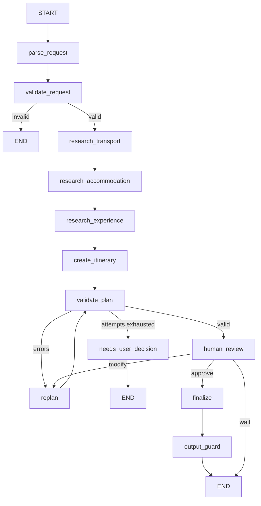

# AI Travel Planning Agent

Multi-agent travel planner built with **LangGraph** and **MCP**, with deterministic
validation, re-planning, and human-in-the-loop approval.

> **Status: Phase 3 of 17.** Four agents with restricted tool access, running on mock providers.
> See [PROJECT_PLAN.md](PROJECT_PLAN.md) for the full architecture and phase plan.

## Quick start

```bash
python3 -m venv .venv && source .venv/bin/activate
pip install -r requirements-dev.txt
cp .env.example .env          # works as-is: USE_MOCK_DATA=true, no API keys needed
uvicorn app.main:app --reload
```

Then: <http://localhost:8000/health> · <http://localhost:8000/docs>

```bash
curl -X POST localhost:8000/api/v1/trips -H 'Content-Type: application/json' \
  -d '{"message":"Plan a 5 day trip from Kochi to Delhi for 2 people under Rs 50000"}'
```

## Agents and tool access

| Agent | Tools it may call |
|---|---|
| Travel Manager | none - it builds a scoped brief for each agent and merges their results |
| Transport Agent | `search_flights`, `search_trains`, `search_buses` |
| Accommodation Agent | `search_hotels` |
| Experience Agent | `search_places`, `get_weather`, `calculate_route` |

The table lives in [gateway/policy.py](gateway/policy.py) and is enforced on every
tool call. Phase 5 enforces the same table over HTTP at the MCP Gateway.

## Workflow



## Tests

```bash
pytest -q
ruff check . && ruff format --check .
```

## Documentation

- [PROJECT_PLAN.md](PROJECT_PLAN.md) — architecture, agents, MCP design, phases
- `docs/interview-guide.md` — coming in Phase 17
