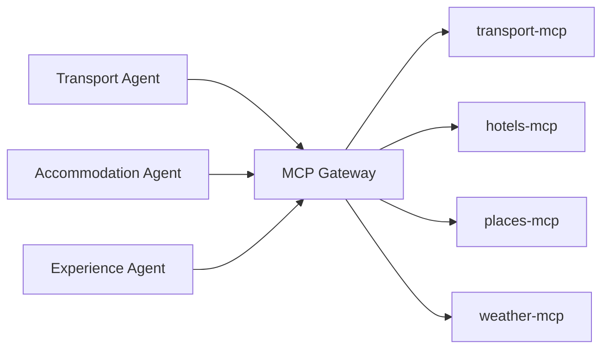
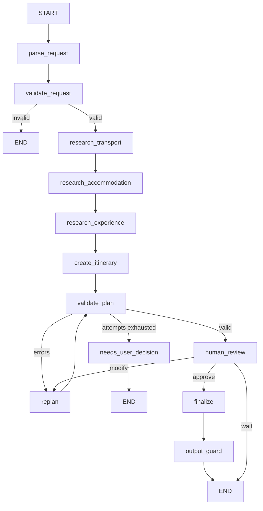

# AI Travel Planning Agent

Multi-agent travel planner built with **LangGraph** and **MCP**, with deterministic
validation, re-planning, and human-in-the-loop approval.

> **Status: Phase 8 of 17.** Input and output guardrails, deterministic validation.
> See [PROJECT_PLAN.md](PROJECT_PLAN.md) for the full architecture and phase plan.

## Quick start

```bash
python3 -m venv .venv && source .venv/bin/activate
pip install -r requirements-dev.txt
cp .env.example .env          # works as-is: USE_MOCK_DATA=true, no API keys needed
uvicorn app.main:app --reload
```

Then: <http://localhost:8000/health> · <http://localhost:8000/docs>

```bash
curl -X POST localhost:8000/api/v1/trips -H 'Content-Type: application/json' \
  -d '{"message":"Plan a 5 day trip from Kochi to Delhi for 2 people under Rs 50000"}'
```

## Guardrails and validation

The dividing line the whole project is built on:

| The LLM | Python |
|---|---|
| reads the traveller's message | computes every date |
| writes the itinerary's prose | computes every rupee |
| explains a recommendation | decides whether a plan is valid |

**Input** ([app/guardrails/input_guard.py](app/guardrails/input_guard.py)) runs in
two places: `check_message` screens the raw text before it reaches a model
(empty, over-long, prompt injection); `check_requirements` checks the extracted
fields (missing city, origin equal to destination, impossible duration or
traveller count, nonsensical budget, broken date range).

Injection filtering is a speed bump, not a wall. The real defences are the
restricted tool access and the validation that follow it.

**Plan validation** ([app/validation/validators.py](app/validation/validators.py))
is six plain functions - dates, transport, hotel, itinerary, daily schedule,
budget - each returning a list of readable errors. No LLM is consulted.

**Output** ([app/guardrails/output_guard.py](app/guardrails/output_guard.py))
re-derives the totals rather than trusting the ones in the state, so a number
that drifted during re-planning is caught before the traveller sees it. It also
blocks anything resembling a credential.

## LLM fallback

```
primary (Groq) --fails--> fallback (Gemini) --fails--> rule-based reading
```

One retry on the primary covers a transient blip; after that the fallback gets
one attempt. A reply that does not match the Pydantic schema counts as a
failure, so a malformed answer falls back too rather than being half-trusted.

There is no router, no model scoring and no cost optimiser. The only question
this design answers is "the primary is down, can we keep going?".

If **no** provider answers - including the case where no API key is configured at
all - requirements are read with a plain keyword reader instead, and the response
says so:

```json
"degraded": ["no LLM available, requirements were read with simple rules"]
```

That is what lets the whole system run with zero API keys. A degraded extraction
is always labelled; it never passes for a normal one.

## Data sources

`USE_MOCK_DATA=true` (the default) runs the whole system offline with no API keys.
Every payload carries a `source` field, so where a result came from is visible in
the data and not only in the configuration.

| Domain | Mock | Real |
|---|---|---|
| Weather | seasonal, deterministic | Open-Meteo - free, no key |
| Routes | distance x road factor | OSRM - free, no key |
| Flights, trains, buses | derived from real distances | none: no free Indian API exists |
| Hotels | rating-correlated pricing | none |

With `USE_MOCK_DATA=false` the weather and route tools go live; the transport and
hotel tools raise instead of quietly serving mock data. That is deliberate - the
system never substitutes invented data for data you asked to be real. It also
means false is only useful for demonstrating live providers, not for planning a
whole trip, so the default is true.

## Caching and failure handling

Redis caches read-tool results, keyed on the tool name plus its sorted arguments,
with a lifetime per tool: 15 minutes for prices, an hour for weather, a day for
places and routes. Locally that turns a 298 ms search into a 0.4 ms one.

Redis is a speed-up, never a source of truth. If it is down the system plans
normally, and the rate limiter falls back to an in-process counter rather than
quietly letting every call through.

When an MCP server fails:

- **Part of a domain** (trains down, flights up) - the plan continues on what is
  left and the response says what was missed.
- **A whole leg** (no transport at all, or no hotel) - the plan is rejected. An
  itinerary with no way to get there is not a cheap plan, it is an incomplete
  one, and the total would silently omit the cost.

The message tells the truth about which happened: an outage is never reported as
a budget problem.

## MCP Gateway

Every tool call goes through the gateway. It is the only door between the agents
and the MCP servers.



| Responsibility | How |
|---|---|
| Authentication | `X-API-Key` header must match `MCP_GATEWAY_API_KEY` |
| Identity | `X-Agent-Name` header says which agent is calling |
| Authorization | `AGENT_TOOL_ACCESS` in [gateway/policy.py](gateway/policy.py); a cross-domain call is `403` |
| Discovery | `GET /tools` returns only that agent's tools, so its LLM never sees the rest |
| Routing | `TOOL_SERVER` maps each tool to the MCP server that owns it |
| Rate limiting | 60 calls/agent/minute, `429` beyond that (Redis-backed in Phase 6) |
| HITL | action tools (`book_*`) are refused without an approval token |
| Logging | one line per call: agent, tool, trip, duration, status |

Failures map to status codes an agent can act on: `503` for an unreachable MCP
server (carry on with the other tools), `400` for bad arguments, `429` for rate
limits, `403` for anything unauthorized.

### One process or five

`SPLIT_PROCESSES=false` (the default) runs the agents, gateway and MCP servers
in one process: no ports to manage, fast tests. `SPLIT_PROCESSES=true` makes both
hops real HTTP - agents to gateway, gateway to MCP - which is how docker-compose
runs it. Start the extra processes with `python scripts/run_services.py`.

The authorization, rate limiting and routing code is identical either way; only
the wire between the pieces changes.

## MCP servers

Four custom MCP servers built with FastMCP, each serving streamable HTTP at `/mcp`:

| Server | Port | Tools |
|---|---|---|
| `mcp_servers/transport` | 9101 | `search_flights`, `search_trains`, `search_buses` |
| `mcp_servers/hotels` | 9102 | `search_hotels` |
| `mcp_servers/places` | 9103 | `search_places`, `calculate_route` |
| `mcp_servers/weather` | 9104 | `get_weather` |

Run one standalone with `python -m mcp_servers.transport.server`. Routes live in
the places server because both tools answer geography questions from the same
city table - a maps server of its own would be a folder for appearance.

## Agents and tool access

| Agent | Tools it may call |
|---|---|
| Travel Manager | none - it builds a scoped brief for each agent and merges their results |
| Transport Agent | `search_flights`, `search_trains`, `search_buses` |
| Accommodation Agent | `search_hotels` |
| Experience Agent | `search_places`, `get_weather`, `calculate_route` |

The table lives in [gateway/policy.py](gateway/policy.py) and is enforced on every
tool call. Phase 5 enforces the same table over HTTP at the MCP Gateway.

## Workflow



## Tests

```bash
pytest -q
ruff check . && ruff format --check .
```

## Documentation

- [PROJECT_PLAN.md](PROJECT_PLAN.md) — architecture, agents, MCP design, phases
- `docs/interview-guide.md` — coming in Phase 17
