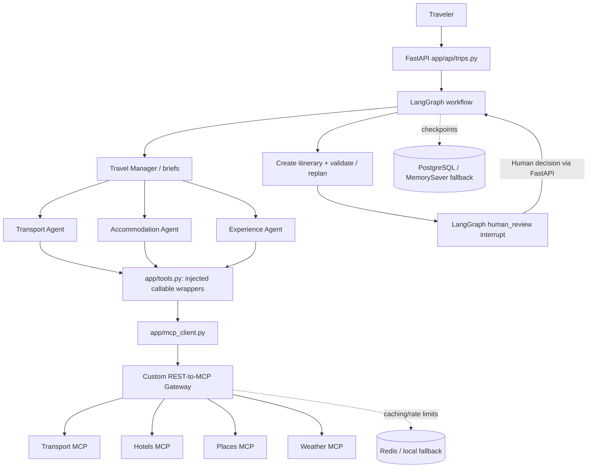
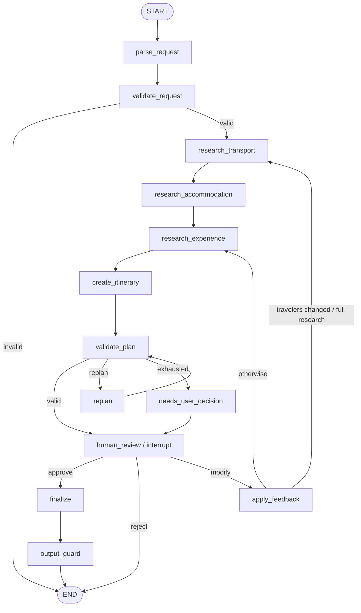

# AI Travel Planning Agent — Complete Beginner-Friendly Project Guide

> **Based on the code in `travel-agent.zip`.** This guide explains the project’s purpose, architecture, agents, custom REST-to-MCP gateway, the precise tool-call chain, LangGraph Human-in-the-Loop (HITL), persistence, failure handling, setup, and interview explanations.
>
> **Scope:** This is a **travel planning and itinerary approval** system. **No real flights, trains, buses, or hotel rooms are booked. No payment is made or ticket issued.** Mock travel data is the default. An approved itinerary means the *plan* was approved, not a reservation.

## Contents

1. [What the project does](#1-what-the-project-does)
2. [Technology stack and responsibilities](#2-technology-stack-and-responsibilities)
3. [Big-picture architecture](#3-big-picture-architecture)
4. [Repository tour](#4-repository-tour)
5. [Walkthrough: starting a new trip](#5-walkthrough-starting-a-new-trip)
6. [The specialist agents and deterministic selection](#6-the-specialist-agents-and-deterministic-selection)
7. [MCP fundamentals: server, client, tool and gateway](#7-mcp-fundamentals-server-client-tool-and-gateway)
8. [Why we built a custom MCP gateway](#8-why-we-built-a-custom-mcp-gateway)
9. [Exact call chain: `transport_agent(brief, get_tools(...))`](#9-exact-call-chain-transport_agentbrief-get_tools)
10. [Gateway implementation, file by file](#10-gateway-implementation-file-by-file)
11. [In-process versus separate-process modes](#11-in-process-versus-separate-process-modes)
12. [LangGraph workflow, validation and re-planning](#12-langgraph-workflow-validation-and-re-planning)
13. [Human-in-the-Loop: pause, approve, modify, reject](#13-human-in-the-loop-pause-approve-modify-reject)
14. [Two kinds of human approval — and what is NOT implemented](#14-two-kinds-of-human-approval--and-what-is-not-implemented)
15. [PostgreSQL, Redis, logging and observability](#15-postgresql-redis-logging-and-observability)
16. [Run the system and try the APIs](#16-run-the-system-and-try-the-apis)
17. [Common doubts and important limitations](#17-common-doubts-and-important-limitations)
18. [Interview-ready explanations](#18-interview-ready-explanations)
19. [Recommended study order](#19-recommended-study-order)

---

## 1. What the project does

A traveler writes a natural-language request:

> “Plan a three-day trip from Kochi to Bangalore for two people. Budget ₹20,000. Prefer a train if it takes at most 12 hours. I enjoy historical places.”

The application:

1. Parses the request into structured requirements (origin, destination, travelers, dates, budget, interests and constraints).
2. Validates the requirements.
3. Researches flight, train and bus choices.
4. Researches hotels.
5. Researches places, routes and weather.
6. Builds a day-by-day itinerary and estimated cost.
7. Checks deterministic rules: budget, trip constraints, and plan validity.
8. Attempts automatic re-planning when possible.
9. **Pauses and shows the itinerary to the traveler**.
10. Resumes when the traveler **approves**, **requests modifications**, or **rejects** it.
11. Finalizes an approved plan and saves trip data.

**Core design idea:** “The model reasons, Python decides.” The LLM helps interpret natural language and write descriptions, but explicit comparisons (prices, journey duration, validation rules, etc.) are implemented in Python.

**Not a booking engine.** Research results and prices may be mocked or sourced from configured providers. Do not describe them as confirmed inventory unless a live provider actually confirms them.

## 2. Technology stack and responsibilities

| Component | Job |
|---|---|
| FastAPI | REST API for creating, viewing, approving and modifying trips |
| LangGraph | Stateful orchestration: nodes, edges, conditional routing, loops, interrupts |
| Specialist Python agents | Choose transport, accommodation and experiences |
| Groq/Gemini LLM integration | Read natural-language requirements/feedback and generate descriptions, with fallback |
| FastMCP servers | Expose travel research functions as MCP tools |
| **Custom REST-to-MCP Gateway** | Authenticate callers, authorize tools, cache, rate-limit, route and log |
| Pydantic | Validate API payloads and typed tool/agent results |
| PostgreSQL | Persist trip records/events and, when available, LangGraph checkpoints |
| Redis | Cache and rate-limit support (with local fallbacks in some paths) |
| Prometheus metrics | Track tool calls, latency and workflow instrumentation |
| Docker Compose | Run app, gateway/MCP services, PostgreSQL and Redis |
| Pytest / evaluation scripts | Test business rules and agent output behavior |

## 3. Big-picture architecture



**Note:** In the real workflow, research nodes execute **sequentially** (transport → accommodation → experience). The agent boxes above illustrate their shared tool-access architecture, not parallel execution. When `SPLIT_PROCESSES=false`, gateway service methods are called in-process instead of via a separate HTTP gateway process.

## 4. Repository tour

```text
travel-agent/
├── app/
│   ├── main.py                  # FastAPI startup, routes, middleware, health, metrics
│   ├── api/trips.py             # Create / approve / modify / message / list / get trips
│   ├── graph/
│   │   ├── graph.py             # LangGraph nodes, edges and branch decisions
│   │   ├── nodes.py             # Workflow node implementations, HITL, feedback
│   │   └── state.py             # Shared TravelState and new_state()
│   ├── agents/                  # Transport, accommodation, experience, Travel Manager
│   ├── tools.py                 # Inject allowed tool wrappers into agents
│   ├── mcp_client.py            # In-process or HTTP gateway caller
│   ├── db/                      # Trip records/events and LangGraph checkpointer
│   ├── guardrails/              # Input/output safeguards
│   ├── validation/              # Deterministic plan checks and repair rules
│   ├── llm/                     # LLM calls, fallback, usage reporting
│   └── metrics.py               # Metrics
├── gateway/
│   ├── server.py                # FastAPI REST gateway endpoints
│   ├── service.py               # Gateway's tool execution pipeline
│   ├── policy.py                # Agent-to-tool permissions and action tool categories
│   ├── mcp_router.py            # Route a tool name to its MCP server
│   └── ...                      # Cache and associated helpers
├── mcp_servers/                 # FastMCP transport/hotels/places/weather services
├── evaluation/                  # Evaluation assets
├── tests/                       # Automated tests
├── docker-compose.yml
├── .env.example
└── README.md                    # Original repository README
```

**Read in call order, not alphabetical order:** `app/api/trips.py` → `app/graph/graph.py` → `app/graph/nodes.py` → `app/agents/` → `app/tools.py` → `app/mcp_client.py` → `gateway/` → `mcp_servers/`.

## 5. Walkthrough: starting a new trip

A client sends:

```http
POST /api/v1/trips
Content-Type: application/json
```

```json
{"message":"Plan a three-day Kochi to Bangalore trip for 2 people under Rs 20000"}
```

In `app/main.py`, FastAPI registers the trip router. In `app/api/trips.py`, `create_trip()` then:

1. Generates a UUID `trip_id`.
2. Builds `config = {"configurable": {"thread_id": trip_id}}`.
3. Calls `new_state(trip_id, request.message)`.
4. Creates an initial trip row and records the `trip_requested` event.
5. Calls `get_graph().invoke(initial, config=config)`.
6. Saves the state and plan; records metrics and events.
7. Returns a `TripResponse`, including `awaiting_decision` when the graph is paused.

`thread_id` is critical: LangGraph uses it to locate the same saved workflow on later API calls. **Trip ID and LangGraph thread ID are the same identifier in this project.**

The graph begins at the explicitly wired edge:

```python
graph.add_edge(START, "parse_request")
```

Calling `invoke()` doesn't mean “ask the LLM to choose what starts.” The compiled graph explicitly defines its starting node.

## 6. The specialist agents and deterministic selection

The **Travel Manager** coordinates research and prepares small domain-specific `brief` dictionaries. It does not need to call every tool directly.

### Transport Agent

Its permitted tools are `search_flights`, `search_trains`, `search_buses`. Its main function (from `app/agents/transport_agent.py`) receives `brief` plus `tools`:

```python
def research_transport(brief: dict, tools: dict) -> TransportResult:
    options = []
    failures = []
    for mode, tool_name in SEARCHES.items():
        try:
            raw = tools[tool_name](
                origin=brief["origin"],
                destination=brief["destination"],
                date=brief["date"],
                passengers=brief["travelers"],
            )
            options.extend(TransportOption(**item) for item in raw)
        except Exception as exc:
            failures.append(f"{mode} search unavailable")
    # Then _choose(...) and _alternatives(...)
```

**Example hypothetical choices** (not live prices):

| Mode | Duration | Price per person |
|---|---:|---:|
| Train A | 10 h | ₹1,200 |
| Train B | 14 h | ₹800 |
| Flight | 1.5 h | ₹4,500 |
| Bus | 11 h | ₹900 |

If preferred mode is `train` and `max_journey_hours` is `12`, `_choose()` filters preferred trains to those within 12 hours and chooses the cheapest remaining: **Train A**. If all preferred trains exceed the limit, it searches **all modes** that meet the limit and chooses the cheapest. If none of the modes meet the limit, it falls back to the cheapest available and explains why. Thus the time preference is not an absolute hard failure in this function; downstream validation must handle strict constraints.

`_alternatives()` keeps the cheapest available backup from each mode and then fills up to `MAX_ALTERNATIVES = 6` with cheaper runners-up. The re-planner can use these alternatives when a trip is too expensive or invalid.

**Failures are isolated:** one tool timeout should not prevent the other transport modes being searched. **Pydantic** `TransportOption`/`TransportResult` validates and structures agent output.

### Accommodation and Experience Agents

The Accommodation Agent obtains hotel choices through `search_hotels`. The Experience Agent uses `search_places`, `get_weather`, `calculate_route`. They are supplied their own filtered tool dictionaries. They do not need to understand gateway HTTP details.

## 7. MCP fundamentals: server, client, tool and gateway

- **MCP server:** Exposes named callable functions (e.g. `search_trains`) using Model Context Protocol.
- **MCP client:** Connects to an MCP server, initializes an MCP session and invokes tools.
- **MCP tool:** A capability with a name, input arguments and a result.
- **MCP Gateway (this project):** A **custom Python/FastAPI REST front door** that mediates which agent may call which MCP tool and directs calls to the right MCP server.

The custom gateway is **not** a fully MCP-speaking endpoint on the *agent side*. The agent-side request is a Python call or `POST /call` REST request; the gateway-to-MCP-server connection uses actual MCP in split-process mode. Calling it a **REST-to-MCP gateway** is the most precise description.

## 8. Why we built a custom MCP gateway

Without a gateway, each agent's MCP client would need shared mechanisms for authentication, access control, rate limits, caching, and logs. That can lead to duplicated policy logic.

The gateway centralizes:

1. **Authentication:** API key at the HTTP boundary (`gateway/server.py`).
2. **Identification:** `X-Agent-Name` header tells the gateway which agent is calling.
3. **Authorization:** `gateway/policy.py` checks whether this agent can run this tool.
4. **Caching:** Reuse responses for read-only queries when valid.
5. **Rate limiting:** Protect MCP services from excessive uncached tool calls.
6. **Routing:** Resolve tool name to transport/hotels/places/weather MCP server.
7. **Observability:** Structured logs, metrics, cache-hit and error counts.
8. **Preliminary action guard:** Flag future action tools that would need human approval.

**Authorization is an important reason**, but note the security scope: a shared API key plus caller-provided `X-Agent-Name` is appropriate only for a trusted internal boundary. It does not cryptographically bind different agents to distinct identities. A public production gateway would need stronger credentials and authorization.

## 9. Exact call chain: `transport_agent(brief, get_tools(...))`

The actual line in `app/graph/nodes.py` is:

```python
result = transport_agent(brief, get_tools("transport_agent"))
```

It is equivalent to:

```python
tools = get_tools("transport_agent")
result = transport_agent(brief, tools)
```

### Step 1 — `get_tools()` returns callable wrappers, not search results

`app/tools.py`:

```python
from app.mcp_client import call_tool
from gateway.policy import allowed_tools

def get_tools(agent: str, trip_id: str | None = None) -> dict:
    return {
        name: _gateway_call(agent, name, trip_id)
        for name in sorted(allowed_tools(agent))
    }

def _gateway_call(agent: str, tool: str, trip_id: str | None):
    def call(**arguments):
        return call_tool(agent, tool, arguments, trip_id=trip_id)
    call.__name__ = tool
    return call
```

`allowed_tools("transport_agent")` is read from `gateway/policy.py` and returns just `search_flights`, `search_trains`, `search_buses`.

`_gateway_call()` returns an inner function that **remembers** (`agent`, `tool`, `trip_id`). This is a Python **closure**. A dictionary of wrappers is created, conceptually:

```python
{
    "search_flights": <callable wrapper>,
    "search_trains": <callable wrapper>,
    "search_buses": <callable wrapper>,
}
```

**No flight/train/bus searches have happened yet.**

### Step 2 — Transport Agent calls a wrapper

`tools["search_trains"](origin=..., destination=..., date=..., passengers=...)` executes that closure. The closure calls:

```python
call_tool(
    agent="transport_agent",
    tool="search_trains",
    arguments={
        "origin": "Kochi",
        "destination": "Bangalore",
        "date": "2026-11-10",
        "passengers": 2,
    },
    trip_id=None,
)
```

`trip_id=None` because the actual call to `get_tools("transport_agent")` does not supply it. Passing `get_tools("transport_agent", trip_id=state["trip_id"])` would improve per-trip tool traceability.

### Step 3 — `app/mcp_client.py` chooses communication mode

```python
def call_tool(agent, tool, arguments, trip_id=None):
    if settings.split_processes:
        return _call_over_http(agent, tool, arguments, trip_id)
    return _call_in_process(agent, tool, arguments, trip_id)
```

**HTTP mode:**

```http
POST http://mcp:9000/call
X-API-Key: <configured key>
X-Agent-Name: transport_agent
Content-Type: application/json
```

```json
{
  "tool": "search_trains",
  "arguments": {"origin":"Kochi","destination":"Bangalore","date":"2026-11-10","passengers":2},
  "trip_id": null
}
```

**In-process mode:** directly invokes `gateway.service.execute_tool(...)` without making that HTTP request.

### Step 4 — Gateway applies policies and calls the MCP router

```text
Transport Agent
   → app/tools.py: get_tools() callable
   → app/mcp_client.py: call_tool()
   → gateway/server.py: POST /call          [HTTP mode only]
   → gateway/service.py: execute_tool()
        → check_access()
        → action approval requirement check
        → cache lookup
        → rate-limit check on cache miss
        → gateway/mcp_router.py: call_tool()
             → transport MCP server: search_trains
   ← normalized train result
Transport Agent: combine results → _choose() → _alternatives()
   → Travel Manager/LangGraph
```

**This is dependency injection:** the agent receives a capability (`tools` dictionary) instead of hardcoding gateway URLs, HTTP libraries or MCP client code. The same agent logic works with different tool implementations and can be unit-tested with fake functions.

## 10. Gateway implementation, file by file

### `gateway/policy.py` — tool permissions

```python
AGENT_TOOL_ACCESS = {
    "travel_manager": set(),
    "transport_agent": {"search_flights", "search_trains", "search_buses"},
    "accommodation_agent": {"search_hotels"},
    "experience_agent": {"search_places", "get_weather", "calculate_route"},
}
```

`allowed_tools(agent)` determines what tool wrappers are injected. `check_access(agent, tool)` **rechecks** authorization at execution time, so even an attempt to bypass wrapper filtering can be rejected.

`READ_TOOLS` includes all research tools. `ACTION_TOOLS` includes `book_flight`, `book_train`, `book_bus`, `book_hotel`, but **these are not working booking implementations and are not allowed by the current agent permissions**.

### `gateway/server.py` — HTTP API

- `GET /health`: basic status.
- `GET /tools`: authenticated, agent-filtered discovery of accessible tools.
- `POST /call`: authenticated tool invocation.
- `GET /metrics`: gateway Prometheus metrics.

The `POST /call` handler reads the API key and agent name headers and forwards a `ToolCallRequest` to `gateway.service.execute_tool(...)`.

### `gateway/service.py` — execution order

Actual order in `execute_tool(...)`:

1. `check_access(agent, tool)` — reject unauthorized tools.
2. `requires_human_approval(tool)` — require a token for action tools.
3. For read tools: compute cache key and return cached result if present.
4. `check_rate_limit(agent)` — runs after cache hit check.
5. `mcp_router.call_tool(tool, arguments)` — execute actual tool.
6. Cache successful read result using a per-tool TTL.
7. Record call metrics, status, duration and structured log fields.

If an MCP tool fails, the service logs the error and propagates it so the caller can handle degraded research.

### `gateway/mcp_router.py` — mapping and MCP session

```python
TOOL_SERVER = {
    "search_flights": "transport",
    "search_trains": "transport",
    "search_buses": "transport",
    "search_hotels": "hotels",
    "search_places": "places",
    "calculate_route": "places",
    "get_weather": "weather",
}
```

In split-process mode, `_call_over_http(...)` uses `streamablehttp_client`, `ClientSession`, `session.initialize()`, and `session.call_tool(tool, arguments)` to talk MCP to the selected server. `_unwrap(...)` converts MCP structured/text result shapes into ordinary Python data for the agent.

**Key distinction:** Gateway `POST /call` is an ordinary REST endpoint. A downstream `session.call_tool()` is a real MCP operation.

## 11. In-process versus separate-process modes

| `SPLIT_PROCESSES` | Application → gateway | Gateway → MCP tool | Best for |
|---|---|---|---|
| `false` | Direct Python `gateway.service.execute_tool(...)` | In-process FastMCP call | Fast local iteration and tests |
| `true` | HTTP `POST /call` to gateway | MCP Streamable HTTP client/session | Demonstrating real service boundaries |

Docker Compose starts an **app** container and an **mcp** container; the latter launches the gateway and four MCP servers as five processes in one container. It also runs PostgreSQL and Redis as separate services. Hence Docker Compose contains four service definitions (`app`, `mcp`, `postgres`, `redis`), with multiple processes inside `mcp`.

Both modes use the same gateway *policy/service* logic, but HTTP authentication happens only when the request actually crosses the HTTP boundary. In-process mode is not a separately isolated gateway network hop.

## 12. LangGraph workflow, validation and re-planning

From the actual `app/graph/graph.py`:



**Sequential research is deliberate:** the hotel stage can depend on transportation dates and choices. `validate_plan` can loop through automatic repairs. A user modification is a *separate* feedback loop from automatic re-planning.

`TravelState` is the shared data structure containing the request, selections, alternatives, costs, errors, status, feedback, and attempt counts. Each graph node returns updates; LangGraph applies them to state. Conditional edges in `graph.py` determine the next node.

## 13. Human-in-the-Loop: pause, approve, modify, reject

### Why HITL exists here

The project does **not** need user permission to search for hotels or trains. It needs a human to **review the proposed itinerary** and decide whether to accept or change it before finalization.

### Pause point: `app/graph/nodes.py`

```python
def human_review(state: TravelState) -> dict:
    errors = state.get("validation_errors", [])
    options = ["modify", "reject"] if errors else ["approve", "modify", "reject"]

    decision = interrupt({
        "summary": travel_manager.summarize_for_human(state),
        "total_cost": state.get("total_cost"),
        "budget": state.get("budget"),
        "problems": errors,
        "message": state.get("final_response") or "",
        "options": options,
    })
    # On resume, decision is supplied by Command(resume=...)
```

`interrupt()` pauses the graph, and the configured LangGraph checkpointer retains the workflow's state. FastAPI returns control to the requester along with an `awaiting_decision` description. The app is **not** running a busy background loop awaiting user input.

If the plan has unresolved validation errors, `approve` is **not** offered; the user can only modify or reject it.

### Resume point: `app/api/trips.py`

The approver sends:

```http
POST /api/v1/trips/{trip_id}/approve
Content-Type: application/json
```

```json
{"approved":true}
```

For modification:

```http
POST /api/v1/trips/{trip_id}/modify
Content-Type: application/json
```

```json
{"feedback":"Use a cheaper hotel and add more historical places"}
```

`approve_trip()` or `modify_trip()` calls `_resume(...)`. This function:

1. Reuses `config = {"configurable": {"thread_id": trip_id}}`.
2. Calls `get_graph().get_state(config)` to confirm the trip exists.
3. Inspects pending interrupts and checks whether the requested action is offered.
4. Records a human-decision event.
5. Executes `get_graph().invoke(Command(resume=decision), config=config)`.
6. Saves the resulting trip and returns its updated response.

`Command(resume=...)` supplies the answer to the paused `interrupt()`. LangGraph resumes **the same thread**, not a brand-new planning session. The interrupted node can be re-entered from its beginning during replay; code before `interrupt()` should be safe to run again.

### Branches after human decision

| Decision | Graph behavior | Actual outcome |
|---|---|---|
| **Approve** | `human_review → finalize → output_guard → END` | Approved itinerary saved; **no booking** |
| **Modify** | `human_review → apply_feedback → research affected stages → create_itinerary → validate_plan → human_review` | New plan shown for review |
| **Reject** | `human_review → END` | Trip workflow marked rejected |

`apply_feedback()` interprets the user’s message, updates preferences/budget/interests or selects cheaper options. Changing traveler count triggers full research (prices depend on number of travelers); other modifications may go through experience research only to avoid undoing chosen cheaper alternatives.

**Human review happens once per plan version**, not after every individual search tool call.

## 14. Two kinds of human approval — and what is NOT implemented

This project mentions approval in two separate places. They are **not the same feature**.

**A. Working LangGraph HITL:** The traveler approves, modifies or rejects an itinerary. Implemented by `human_review()` + `interrupt()` + `Command(resume=...)`.

**B. Gateway action-tool approval policy:** `requires_human_approval()` identifies future `book_*` operations as requiring a token. But the project currently does not implement real booking actions or grant them to agents; the token existence check is not a complete secure authorization lifecycle. **Do not claim this means a flight/hotel is actually booked.**

**What an approved itinerary does:** sets human-approved state, finalizes a response, performs output validation, persists the plan. **What it does not do:** reserve inventory, transfer money, create a confirmation number, or issue a ticket.

A future production booking design would require live providers, available inventory confirmation, user consent tied to specific price/terms, a verified one-time approval grant, idempotency, booking status reconciliation and payment security.

## 15. PostgreSQL, Redis, logging and observability

### PostgreSQL

There are two complementary persistence purposes:

- **Application trip records and events:** support listing trips, looking up status, and viewing history (`app/db/database.py`).
- **LangGraph checkpoints:** store workflow state and interrupt position so the same `thread_id` can be resumed (`app/db/checkpointer.py`).

The checkpointer tries PostgreSQL `PostgresSaver` first and falls back to `MemorySaver()` when PostgreSQL is unavailable. In-memory checkpoints **do not survive process restarts**. The API graph is built lazily through `get_graph()` and shared within its process.

### Redis

Supports caching and rate-limit bookkeeping, with fallbacks in gateway helpers where configured. Cache keys are based on tool name and arguments; cacheable results are read-tool results. A cache hit occurs before the rate limit check because the downstream MCP server is not called.

### Logs and metrics

`app/main.py` attaches request identifiers and response timing headers. The gateway records fields such as agent, tool, trip ID (when supplied), duration, status, cache hit and error. `GET /metrics` exists on both application and gateway processes, which matters because each process owns its own metrics when run separately.

### Failure behavior

A failed transport search is logged and added to the agent's `failures` list; successful results from other modes can still be used. Provider/LLM failures can trigger fallbacks or degraded responses, but not every failure is silently recoverable. Read actual failure messages and validation errors instead of assuming every returned plan is complete.

## 16. Run the system and try the APIs

### Option A: Docker Compose (best way to demonstrate HTTP gateway + MCP)

From the extracted repository:

```bash
cp .env.example .env
# Add optional GROQ_API_KEY / GEMINI_API_KEY in .env; do not commit secrets.
docker compose up --build
```

Relevant addresses in Docker Compose:

- Application Swagger UI: `http://localhost:8000/docs`
- Application health: `http://localhost:8000/health`
- Gateway health: `http://localhost:9000/health`
- Gateway tool list: `http://localhost:9000/tools` (requires headers)
- Gateway metrics: `http://localhost:9000/metrics`
- PostgreSQL mapped to host port `5433`; Redis to host port `6380`.

The provided Compose config sets `SPLIT_PROCESSES=true` and app gateway URL to `http://mcp:9000`; it launches gateway and MCP service processes in the `mcp` container.

`USE_MOCK_DATA=true` is the default, so you can study the architecture without assuming live booking inventory.

### Option B: Local development

Follow the original repository README for full environment requirements. Typical commands:

```bash
python3 -m venv .venv
source .venv/bin/activate
pip install -r requirements-dev.txt
cp .env.example .env
uvicorn app.main:app --reload
```

You can use `SPLIT_PROCESSES=false` locally to avoid running a separate gateway HTTP process. PostgreSQL/Redis connection settings depend on the local services you have started.

### Try a trip

```bash
curl -s -X POST http://localhost:8000/api/v1/trips \
  -H 'Content-Type: application/json' \
  -d '{"message":"Plan a 3 day trip from Kochi to Bangalore for 2 people. Budget Rs 20000. I prefer trains within 12 hours."}'
```

Copy `trip_id` from the response:

```bash
TRIP_ID="paste-the-returned-trip-id"

curl -s -X POST "http://localhost:8000/api/v1/trips/$TRIP_ID/modify" \
  -H 'Content-Type: application/json' \
  -d '{"feedback":"Choose a cheaper hotel"}'

# If the updated plan is valid and 'approve' appears in awaiting_decision.options:
curl -s -X POST "http://localhost:8000/api/v1/trips/$TRIP_ID/approve" \
  -H 'Content-Type: application/json' \
  -d '{"approved":true}'

# Inspect persisted trip and event log:
curl -s "http://localhost:8000/api/v1/trips/$TRIP_ID"
curl -s "http://localhost:8000/api/v1/trips/$TRIP_ID/events"
```

You can reject a pending plan with `POST /api/v1/trips/{trip_id}/approve` and `{"approved":false}`. The code shown does **not** define a dedicated `/reject` route; that distinction matters when explaining APIs.

### Exercise gateway authorization directly

```bash
# Allowed: Transport Agent can search trains
curl -s -X POST http://localhost:9000/call \
  -H 'X-API-Key: dev-gateway-key' \
  -H 'X-Agent-Name: transport_agent' \
  -H 'Content-Type: application/json' \
  -d '{"tool":"search_trains","arguments":{"origin":"Kochi","destination":"Bangalore","date":"2026-11-10","passengers":2}}'

# Forbidden (HTTP 403): Transport Agent is not allowed to search hotels
curl -i -X POST http://localhost:9000/call \
  -H 'X-API-Key: dev-gateway-key' \
  -H 'X-Agent-Name: transport_agent' \
  -H 'Content-Type: application/json' \
  -d '{"tool":"search_hotels","arguments":{}}'
```

The API key above is only the repository's development default; use the key configured in your `.env` rather than assuming it is valid everywhere.

## 17. Common doubts and important limitations

**Q: Is this a custom MCP gateway?**  
**A:** Yes. You built a FastAPI REST front-end backed by shared Python execution policy and an MCP client router. It is most accurately called a **custom REST-to-MCP gateway**.

**Q: Does `get_tools()` itself call an MCP tool?**  
**A:** No. It constructs callables. The tool gets invoked later inside the specialist agent as `tools[tool_name](...)`.

**Q: Why do we pass `tools` as an argument?**  
**A:** Dependency injection: agent logic stays independent of HTTP/MCP transport and easier to test with fake tools.

**Q: Is everything an LLM decision?**  
**A:** No. LangGraph controls workflow; Python compares transport costs/durations and validates constraints. LLMs support natural-language work.

**Q: Is the gateway actually a separate container?**  
**A:** With Docker Compose the gateway runs as a process in the `mcp` container alongside four MCP server processes. The app uses the gateway over HTTP. With `SPLIT_PROCESSES=false`, its service logic runs in-process.

**Q: Does approval book anything?**  
**A:** No. It finalizes the itinerary only.

**Q: Why have `book_*` names in policy?**  
**A:** Future action authorization design; no complete booking execution exists.

**Q: Is HITL in the gateway?**  
**A:** The working **itinerary HITL lives in LangGraph**, not in the gateway. The gateway only has a preliminary action-tool approval requirement.

**Q: Can a plan resume after the API process restarts?**  
**A:** Yes if PostgreSQL checkpointing is active and the compatible persisted state remains; not if only `MemorySaver` was in use.

**Q: What if the Transport Agent uses `search_hotels` anyway?**  
**A:** It is absent from the injected tool dictionary and the gateway's `check_access()` rejects it if called directly.

**Q: Are tool results always real-time live prices?**  
**A:** No. Mock data is enabled by default, and real provider capabilities are limited by provider integrations and configuration.

**Limitations worth mentioning in interviews:**

- Shared API key + caller-supplied agent header is not robust end-user or per-agent authentication for an untrusted network.
- The gateway is REST-to-MCP, not an MCP server protocol endpoint for upstream agents.
- Read-tool caching may return stale travel data; realistic reservations require live availability rechecks.
- Approval-token *presence* is not enough to authorize sensitive real-world actions.
- No real bookings, payments, provider reservation IDs or ticket confirmations.
- `get_tools("transport_agent")` omits optional `trip_id`, reducing gateway log correlation for those calls.
- `_choose()` can fall back to an option outside the journey-time limit when no option meets the limit; distinguish preferences from hard requirements.
- Sequential tool searches are simple but may increase latency.

## 18. Interview-ready explanations

### 30-second project pitch

> I built a stateful multi-agent travel planning system using FastAPI and LangGraph. Specialist agents research transportation, accommodation and attractions through a custom REST-to-MCP gateway. The gateway centrally enforces agent tool permissions, caching, rate limiting and observability. Python applies deterministic selection and validation rules, and LangGraph pauses the generated itinerary for user approval or modifications. PostgreSQL checkpoints let an interrupted trip resume later. The project finalizes approved travel plans; it does not execute real bookings.

### Explain the custom gateway

> Agents don't contain direct MCP or HTTP code. Each agent receives a filtered dictionary of callable tools through dependency injection. A wrapper calls `app/mcp_client.py`, which either invokes the gateway service in-process or sends a REST request to the separate gateway. The gateway authenticates the caller at the HTTP boundary, checks permissions, cache and rate limits, routes the tool to the correct MCP server using an MCP client session, and returns normalized results. This lets the same agents run with local and separate-process infrastructure.

### Explain Human-in-the-Loop

> `human_review()` calls LangGraph's `interrupt()` after itinerary validation. The graph checkpoints its state and returns the proposal for human review. FastAPI accepts approval or feedback and resumes the same `thread_id` using `Command(resume=decision)`. Approval finalizes the plan; modification updates requirements, re-runs relevant planning stages and pauses for another review; rejection ends the workflow. Human approval concerns the itinerary, not ticket purchase.

### Explain design tradeoff: LLM versus Python

> LLMs are useful for interpreting ambiguous text and writing natural-language summaries. Budget calculations, duration checks, selecting the cheapest valid option, and enforcement of gateway permissions are deterministic code because those results should be reproducible and testable.

## 19. Recommended study order

1. `app/main.py` and `app/api/trips.py`: how a request enters, and how the response/approval APIs work.
2. `app/graph/state.py` and `app/graph/graph.py`: the state machine, initial node and conditional routing.
3. `app/graph/nodes.py`: what each research, validation, feedback and HITL node actually does.
4. `app/agents/transport_agent.py`: trace `_choose()` and `_alternatives()` with a concrete dataset.
5. `app/tools.py`: understand **callables, closures and dependency injection**.
6. `app/mcp_client.py`: follow local vs HTTP tool invocation.
7. `gateway/policy.py`, `server.py`, `service.py`, `mcp_router.py`: see why the gateway exists and what it actually checks.
8. `mcp_servers/*/server.py`: identify real MCP tool implementations and their data sources.
9. `app/db/checkpointer.py`: understand interrupted workflow persistence by `thread_id`.
10. Tests, evals, tracing and deployment: validate your understanding by predicting code behavior and comparing with test results.

---

**One-sentence takeaway:** **FastAPI receives the trip request; LangGraph coordinates the planning stages; specialist agents use injected tool wrappers; your custom REST-to-MCP gateway controls and routes MCP tool calls; Python validates the itinerary; and LangGraph HITL pauses for a human to approve, modify, or reject the *plan*—without making a booking.**
